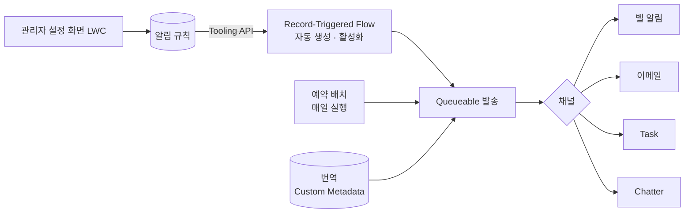

# 노코드 알림 프레임워크 V3

> 관리자가 화면에서 규칙만 만들면 레코드 변경 · 생성 · 예약 조건에 맞춰 알림을 보내는 Salesforce 프레임워크를 V3로 고도화하고 2GP 패키지로 배포했습니다.

| 항목 | 내용 |
|---|---|
| 기간 | 2026.05 – 2026.09 |
| 역할 | 기존 프레임워크 고도화, 버그 수정, 보안 보강, 패키징, 문서화 |
| 형태 | 회사 프로젝트 (사내 솔루션) |
| 기술 | Apex, LWC, Tooling API, Queueable, Batch, Custom Metadata, 2GP Managed Package |

> 회사 프로젝트를 정리한 문서입니다. 회사 소스 코드는 포함하지 않습니다.

## 무엇을 하는가

- 알림 유형: **실시간**(값이 바뀔 때), **생성**(레코드가 만들어질 때), **예약**(매일 조건 검사)
- 발송 채널: 벨 알림, 이메일, Task, Chatter
- 관리자는 오브젝트, 조건식, 받는 사람, 문구만 화면에서 정합니다.

## 구조

## 한 일

### 1. 받는 사람 언어로 보내기
- 이메일과 벨 알림 문구를 **받는 사람의 언어(ko, en, ja, zh)** 에 맞춰 보냅니다.
- 번역을 Custom Metadata로 옮겨 코드 수정 없이 문구를 관리하게 했습니다.

### 2. 중복 발송 버그
- 기존에는 "조건에 쓰인 필드가 바뀌었는가"로 판단해서, 조건과 상관없는 변경에도 알림이 다시 나갔습니다.
- **"전체 조건식이 false에서 true로 바뀌었는가"** 를 메모리에서 계산하도록 바꿨습니다. 지원하지 않는 식은 기존 방식으로 안전하게 넘어갑니다.

### 3. 예약 알림 재설계
- 배치가 끝나면 대상을 다음 날로 넘겨 매일 다시 평가하도록 큐 구조를 바꿨습니다.
- 손상된 데이터 한 건 때문에 설정 화면 전체가 오류로 멈추던 문제를 고쳤습니다.

### 4. 보안 보강
- 동적 SOQL의 오브젝트 이름을 허용 목록으로 검증
- `insert as user`로 필드 권한 강제
- 사용자 모드 조회가 빈 결과를 주던 문제를 권한 세트 보완으로 해결

### 5. 기능 추가와 패키징
- "생성" 알림 유형, 이전 값 자리표시자, 일괄 발송
- 2GP 관리형 패키지로 버전 빌드, 패키지에 넣으면 안 되는 Credential은 별도 배포로 분리
- PRD, 운영 가이드, 사용 안내 페이지 작성

## 배운 점

- 알림은 "보내는 것"보다 **"보내지 말아야 할 때 안 보내는 것"** 이 더 어렵다는 것
